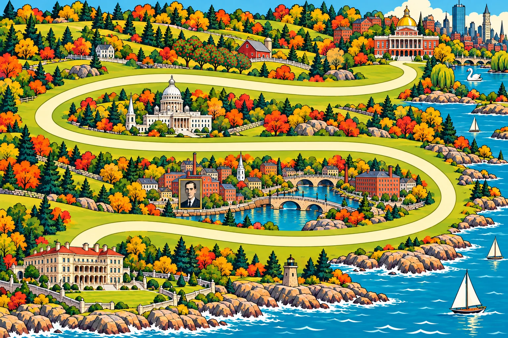
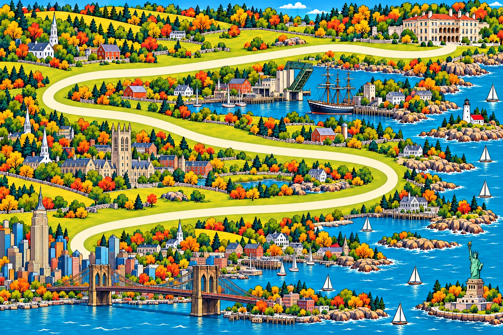
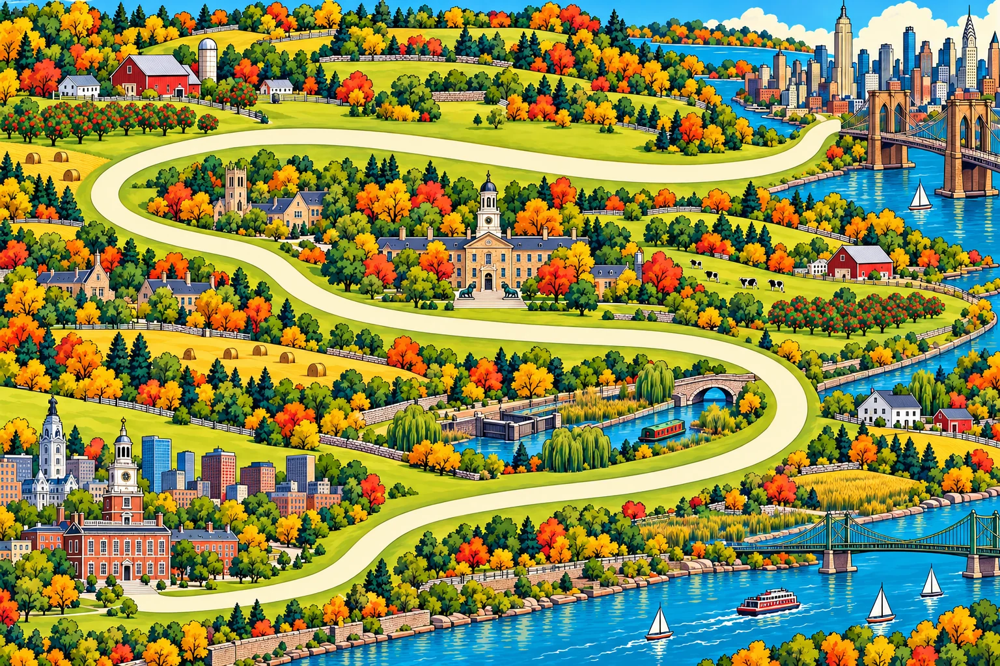
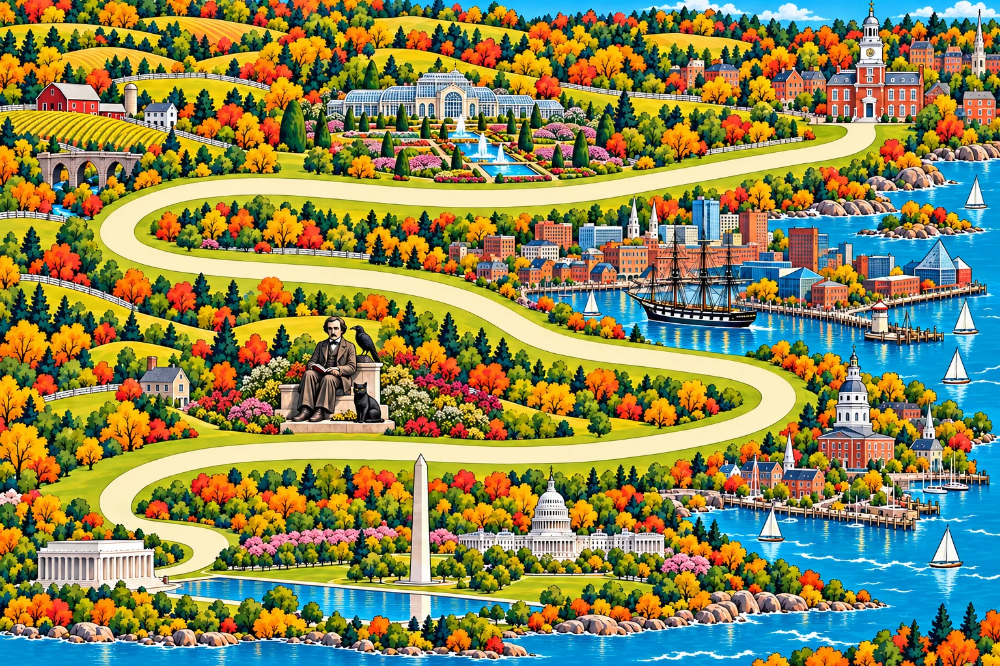
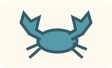
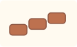
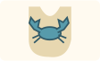
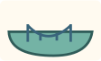

# 汪汪东海岸 · MooMoo 的美国旅行手账

> 汪！我是 MooMoo。从波士顿到华盛顿特区，我和 Yuki、Biscuit、Rex 要走四段路。我的小背包里给纪念品留了位置，肚子里也给晚饭留了位置。

**波士顿 → 纽波特 → 纽约 → 费城 → 华盛顿特区。** 这套美东地图把沿途的城市、港湾和果园画成四张 60 年代美式复古卡通风格的旅行海报。每章从右上方向左下方前进，小路会绕进内陆。地图压缩了真实距离，让四只狗能在一张棋盘上走完这一段。

## 出发前

在项目目录运行 `npm start`，打开[本地游戏](http://127.0.0.1:4175/)，选择 **「美国 · 东海岸漫游」**。你可以独自带 MooMoo 和三位电脑伙伴旅行，也可以四人同屏轮流玩。经典版和狗狗心愿扩展都能搭配这套地图。

轮到走在最后面的狗狗时，点一个前方的空位，它就会沿小路走过去。在**狗狗礼品店**用爪爪币买伴手礼，在**汪友歇脚站**认识新朋友。每一章尽头的驿站都要等伙伴到齐，早到的狗能先挑晚饭。最后按旅途总分决定胜负。

地图工具栏的「MooMoo 讲风景」会讲当前画里的地标。随地图播放的[《MooMoo 的东岸小假期》](../dist/map-packs/east-coast/assets/music/moomoo-east-coast-holiday-v1.mp4)是一首两分钟的复古轻爵士小曲，钢琴和木吉他跟着刷鼓轻轻摇摆。

## 四张旅行地图

### 1. 波士顿 → 纽波特 · 新英格兰海风

我从波士顿州议会大厦的金顶下出发，绕过果园，在普罗维登斯河岸的房屋旁找洛夫克拉夫特的肖像。快看见海的时候，纽波特破碎者大宅的柱廊也露出来了。我最想带走的，当然是能把屋顶掀开的「破碎者大宅零食盒」！

### 2. 纽波特 → 纽约 · 港口与大城市

我在米斯蒂克的开合桥边停一停，看老帆船靠着码头；到纽黑文，抬头找耶鲁校园的哈克尼斯塔。再往前，布鲁克林大桥的石塔把我迎进纽约。自由女神也被画进了港湾，和大桥一起挤进我的小小明信片里。

### 3. 纽约 → 费城 · 花园州慢行

我回头看了一眼帝国大厦，就跟着小路钻进新泽西的果园。普林斯顿拿骚厅前有两只老虎雕像，我穿上橙黑色的虎纹背心，也能加入它们的合照。终点是费城独立宫，红砖墙上竖着白钟楼。

### 4. 费城 → 华盛顿特区 · 首都团圆时光

从费城出发，我先经过长木花园和巴尔的摩内港。去华盛顿的路上，爱伦·坡捧着书，乌鸦站在一旁，黑猫藏在脚边。这组雕像是画里的文学彩蛋。最后，我们四只狗在林肯纪念堂前排排坐，让华盛顿纪念碑和四条小尾巴一起映进倒影池。

## 狗狗礼品店和驿站菜单

下面收录了全部 24 件伴手礼和 14 道鲜食。每件的名字、插画和手账文字都取自美东版。游戏服务启动后，也可以打开[浏览器卡面图鉴](http://127.0.0.1:4175/map-packs/east-coast/gallery.html)，直接跳到想看的类别。

### 小玩具（6 件）

| 卡面 | 名字 | MooMoo 的手账 |
| :---: | --- | --- |
|  | **芬威吱吱棒球** | 我轻轻一咬，白球的红缝线旁就吱了一声。芬威看台的小球迷到啦！ |
|  | **自由钟漏食球** | 我把费城的小钟一推，一粒狗饼干从弯弯的钟缝里滚了出来！ |
|  | **纽约贝果飞盘** | 软胶飞盘有个贝果洞，我刚好能从中间叼住它。 |
|  | **纽波特水手绳结** | 蓝白船绳两头都有结，我叼一头，伙伴叼另一头。 |
|  | **黄出租藏食车** | 我把鼻尖探进毛绒黄出租的车窗，里面藏着一粒狗零食！ |
|  | **蓝蟹响纸偶** | 我一拍巴尔的摩小蓝蟹的布钳子，两边就沙沙响。 |

### 小零食（6 件）

| 卡面 | 名字 | MooMoo 的手账 |
| :---: | --- | --- |
|  | **费城扭结南瓜饼** | 狗狗厨房把南瓜小饼绕成费城扭结的模样，两个小圈上都没有盐粒。 |
|  | **罗岛玉米鸡肉脆** | 袋上画着金色玉米粒，我闻到了熟鸡肉小薄片的香味。 |
|  | **波士顿鳕鱼软粒** | 小鱼印在码头的纸袋上，里面装的是熟透、去刺的鳕鱼软粒。 |
|  | **自由之路胡萝卜小软砖** | 胡萝卜小软块是红砖的颜色，我能用它们铺一小段波士顿自由之路。 |
|  | **普林斯顿苹果软丁** | 袋上有苹果星星，袋里是果园的苹果软丁，果核和籽都取掉啦。 |
|  | **泽西蓝莓爪爪糕** | 蓝莓给犬用小点染上淡紫色，我找到了糕面上和我一样的肉垫印。 |

### 小衣饰（6 件）

| 卡面 | 名字 | MooMoo 的手账 |
| :---: | --- | --- |
|  | **潮汐湖樱花领巾** | 浅蓝领巾飘着粉色花瓣，我把华盛顿湖面的一角系在脖子上啦。 |
|  | **纽波特黄雨衣** | 码头飘雨了。我把两只耳朵从黄雨帽的耳洞里竖起来。 |
|  | **芬威看台棒球帽** | 绿帽檐替我遮住太阳，波士顿的球飞起来，我也抬起了头！ |
|  | **蓝蟹宴接渣兜** | 安纳波利斯的蓝蟹围兜上，两只布钳托着我的小口袋。 |
|  | **纽约地铁拾便袋挂包** | 我的牵引绳上挂着一张迷你地铁图。顺着黄线找到小圆口，就能抽出一只干净的拾便袋啦！ |
|  | **普林斯顿虎纹背心** | 穿上橙黑针织背心，我也想在普林斯顿的校园里拍张合照。 |

### 爪爪艺品（6 件）

| 卡面 | 名字 | MooMoo 的手账 |
| :---: | --- | --- |
|  | **普罗维登斯触手藏书票** | 藏书票里有洛夫克拉夫特的小彩蛋。一条触手替我捧书，角落是我的爪印。 |
|  | **坡先生的乌鸦镇纸** | 我认出了巴尔的摩的乌鸦。翻过书形镇纸，底下还藏着一只黑猫。 |
|  | **破碎者大宅零食盒** | 我掀开纽波特大宅的小屋顶，狗饼干整整齐齐地躺在里面。 |
|  | **布鲁克林桥搪瓷碗** | 小碗两侧各有一座桥塔，吊索沿着蓝色碗边绕了一圈。 |
|  | **独立钟楼剪纸画** | 费城独立厅的红砖墙前立着白钟楼，我在台阶上数到了四对爪印。 |
|  | **倒影池四犬合影** | 我和三个伙伴排排坐。倒影池里有纪念碑，也有四条小尾巴。 |

### 驿站鲜食（14 道）

驿站会从这 14 道菜里翻出当站的共享菜单。每道都是「🐾 狗狗厨房」给小狗准备的旅行餐，每份 6 分，同一只狗一路上每道只能吃一次。MooMoo 第一次点餐时也会提醒小朋友：「你想请真狗狗吃点心时，要先问照顾它的大人哦。」

| 卡面 | 名字 | MooMoo 的手账 |
| :---: | --- | --- |
|  | **罗岛爪印玉米饼** | 我的小烤饼上有个肉垫印，金黄的玉米香从狗碗里飘出来。 |
|  | **纽约小黄伞鸡肉饭** | 小黄伞底下，我的爪印碗盛着原味熟鸡肉和米饭，骨头已经剔净啦。 |
|  | **罗岛白帆鲜鱼清汤** | 白帆画在碗边，清水煮的熟鱼碎都去过刺，我慢慢尝一口。 |
|  | **纽黑文三角鳕鱼饼** | 熟鳕鱼去了刺，做成三角形放在我的碗里，像纽黑文的一枚小旗子。 |
|  | **波士顿鳕鱼土豆羹** | 金顶画在碗上，碗里是去刺熟鳕鱼和捣绵的熟土豆。 |
|  | **曼哈顿圆环熟鲑鱼饼** | 厨师把去刺熟鲑鱼做成小圆环，我从切面看见了粉色的熟鱼碎。 |
|  | **普林斯顿苹果鸡肉盅** | 小陶盅里是去核去籽的苹果丁，下面藏着去骨熟鸡肉。 |
|  | **费城长舟火鸡饭** | 长长的小舟碗驶到我面前，里面是去皮去骨的熟火鸡肉和米饭。 |
|  | **泽西桃丁瘦鸭肉** | 厨师取走桃核，把桃肉切小，和去皮去骨的熟鸭肉一起装进我的碗。 |
|  | **南费城薄切牛肉碗** | 我的那份是切薄的原味熟瘦牛肉，在爪印碗里排出一个小扇面。 |
|  | **巴尔的摩小蓝蟹饭** | 蓝蟹在碗沿上招手。饭里只有一点熟透、去净壳的蟹肉碎。 |
|  | **米斯蒂克龙虾小船** | 小船形狗碗靠岸啦，碗里是一点熟透、去了壳的原味龙虾肉。 |
|  | **华盛顿小推车双肉丸** | 红白棚下，厨师把两颗原味熟瘦肉丸切开，放进我的小狗碗。 |
|  | **潮汐湖四爪野餐篮** | 篮盖一开，MooMoo、Yuki、Biscuit、Rex 各有一个署名餐盒。我找到我的啦！ |
